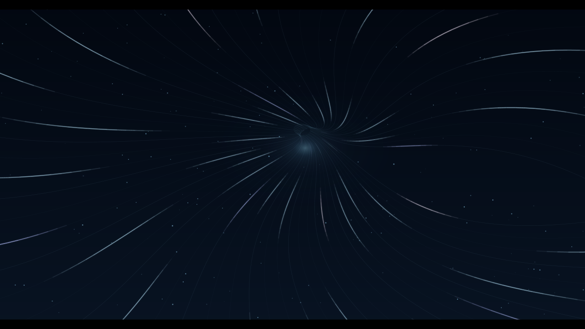
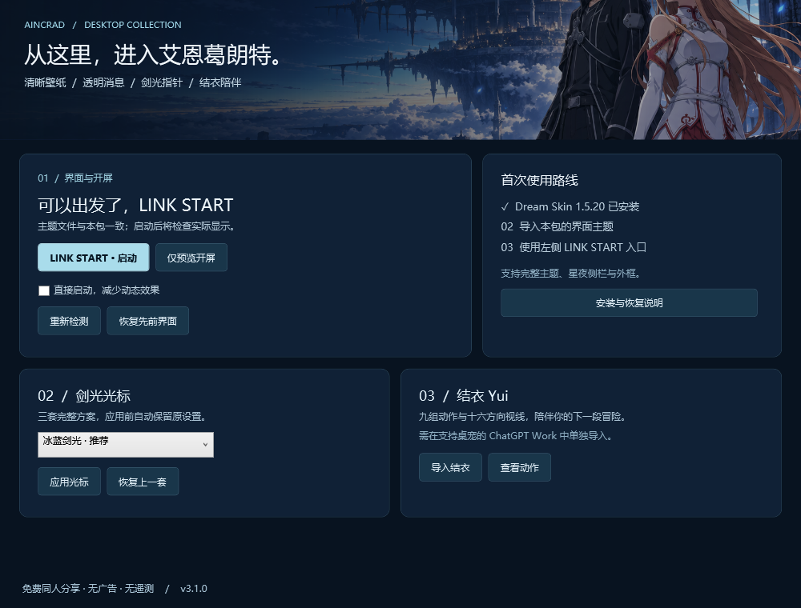
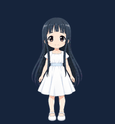

# 艾恩葛朗特 · 免费桌面整合包

一套《刀剑神域》主题的 Windows 桌面外观资源：清晰壁纸、透明对话区域、星夜侧栏、银蓝边框、LINK START 开屏、三套剑光鼠标指针，以及结衣桌宠。

**免费分享，代码开放，无广告、无遥测。非官方同人项目。** 代码和素材的许可范围分别见 [LICENSE](LICENSE) 与 [ASSETS-LICENSE.md](ASSETS-LICENSE.md)。



## 下载和使用

从本仓库的 **Releases** 下载整合包，解压到一个固定文件夹，打开 `AincradSuite.exe`（也可以双击 `Start.cmd`）。本源码版本为 **3.1.0**；正式下载以 Release 中实际发布的版本为准。需要完整源码时可以克隆本仓库，或下载对应 Release 的独立源码包，按下文编译。



1. 先安装 Dream Skin 支持的官方桌面客户端，并安装 [Codex Dream Skin](https://github.com/Fei-Away/Codex-Dream-Skin/releases)。本包提供主题与整合入口，不捆绑第三方安装器或登录环境。兼容的客户端由所安装的 Dream Skin 决定；不能保证所有 ChatGPT / Codex 桌面版本都支持换肤。
2. 打开整合入口，按主按钮的提示操作：**获取 Dream Skin → 安装 / 更新皮肤 → LINK START · 启动**。入口检测安装文件，启动器另行确认实际窗口与皮肤显示。从系统原有入口启动不会播放本包开屏。
3. 选择 **冰蓝剑光、小光剑、银翼** 中的一套，点击 **应用光标**。可以随时用 **恢复上一套** 恢复本包上一次应用前的鼠标方案。
4. 点击 **查看桌宠导入说明**，将结衣素材导入自己的 ChatGPT Work 账号。桌宠不是独立运行在所有 Windows 应用之上的程序。

如果只需要主题，用 Dream Skin 托盘菜单的 Import Theme ZIP 导入 `Aincrad-Theme-v2.8.zip`。这个 Safe CSS 主题可以独立使用；原生侧栏细节和外边框由整合入口的可选扩展提供。

勾选 **直接启动，减少动态效果** 可以省去开屏。正常开屏结束后，如应用仍在准备，启动器会显示独立的启动状态窗口，不再让动画最后一帧长时间占满屏幕。只有本次启动流程结束、且窗口皮肤检查通过，才报告成功。失败提示提供处理建议；关闭提示不会强制终止应用或后台引擎。

## 常见情况

- **一直提示安装主题**：点击安装 / 更新。新版比较实际主题和壁纸内容，支持 Dream Skin 导入时自动改名的图片；其他主题或缺少侧栏扩展也会提示更新。
- **应用已打开但没有皮肤**：确认从本包入口启动的是 Dream Skin 的受管应用；正常关闭它后再启动，不要只重复点击开屏。
- **启动超过两分钟**：状态窗口会提示后台仍在运行。查看本机诊断或稍后检查，避免连续重复启动。
- **恢复按钮不可用**：本包尚未为该项创建可用备份。先前通过其他工具修改的设置，不会被当成本包备份。
- **只想看动画**：点击仅预览开屏，不会启动或修改受管应用。

## 收录内容

| 部分 | 内容 |
| --- | --- |
| 界面皮肤 v2.8 | 壁纸不虚化；消息区域透明；输入区局部磨砂；星夜侧栏和细角标边框 |
| LINK START 开屏 | 原生 WPF 动画、柔和光流、无可见跳过按钮；Esc 提前进入启动流程 |
| 三套光标 | 每套 17 个角色，支持多分辨率；忙碌和后台工作指针为动画 |
| 结衣 Yui | 黑长发白裙；9 组状态、16 个视线方向、73 帧透明图集 |
| 恢复与源码 | 上一套光标和界面恢复入口，开屏与整合入口源码，光标生成器 |
| 启动与引导 v3.1 | 安装状态检测、下一步主按钮、减少动态效果、独立启动进度与中文失败提示 |




## 兼容范围

- Windows 10 / 11，Windows PowerShell 5.1 和 .NET Framework 的 WPF 组件。
- 整合入口的高级侧栏 / 外框扩展针对 Dream Skin **1.5.20** 检查和测试。其他版本仅导入 Safe CSS 主题，扩展会跳过，不猜测内部结构。
- Dream Skin 的受管应用配置与官方原配置分离，首次可能需要重新登录；桌面客户端更新可能影响第三方换肤兼容性。
- 背景插画是静态壁纸，动画在开屏和鼠标 / 桌宠部分。结衣的导入需要账号支持 ChatGPT Work 桌宠功能。
- 程序尚未进行商业代码签名；可查看源码和 `SHA256SUMS.txt` 核验下载内容。

## 恢复

在整合入口中点击 **恢复先前界面** 或 **恢复上一套**。本包自己的备份和运行记录存放在当前用户的 `%LOCALAPPDATA%\AincradSuite`，不会上传。

若要完全结束第三方换肤，请使用 Dream Skin 自带的 Restore，退出受管桌面客户端，再从官方原入口重新打开。Dream Skin 使用本机回环调试连接；只停用注入器不等于关闭已打开应用的调试连接，详见 [上游安全说明](https://github.com/Fei-Away/Codex-Dream-Skin/blob/main/SECURITY.md)。

## 从源码编译

在 Windows PowerShell 5.1 中，从仓库根目录运行：

```powershell
powershell.exe -NoProfile -STA -ExecutionPolicy RemoteSigned -File .\scripts\Build.ps1
```

编译会生成 `AincradSuite.exe`、`launcher\AincradLauncher.exe` 和主题 ZIP。已有同名程序时构建会停止，防止覆盖；使用干净源码目录重新构建。

光标资源已经包含在源码中。需要重新生成时，安装 Python 与 Pillow 后运行 `src/generators/` 下的对应生成器。

验证包内容：运行 `scripts/Validate-Package.ps1`。验证启动状态判定与旧启动记录保护：运行 `scripts/Test-Startup.ps1`；它使用临时测试文件，不操作真实账号、注册表或应用进程。预览图用于展示设计；首次使用和安装状态由各台电脑实际检测，预览不是当前机器状态证明。

3.1 的实测范围为当前电脑安装更新与现有受管会话的启动、皮肤显示检查；尚未完成另一台干净电脑的首次安装、注销后启动和不同缩放比例下的完整交互测试。

本包只包含经过白名单挑选的资源和便携源码。没有打包原作者电脑的桌面、应用配置、聊天截图、日志、账号标识、密钥、浏览器配置或桌宠账号记录。发布检查范围见 [PRIVACY.md](PRIVACY.md)。

致谢和素材来源见 [THIRD-PARTY-NOTICES.md](THIRD-PARTY-NOTICES.md)。
