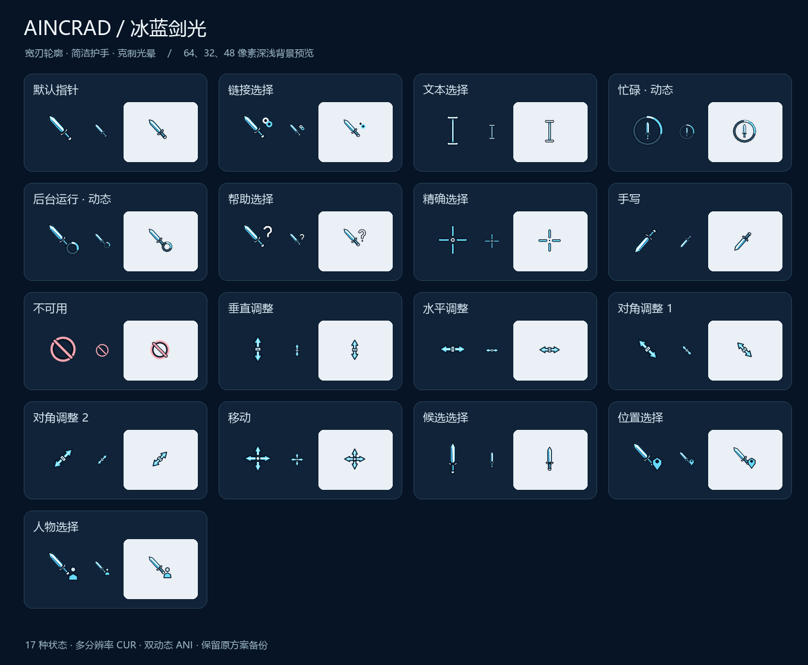

# 艾恩葛朗特 · 免费桌面整合包

《刀剑神域》同人桌面外观资源：透明消息区域、清晰背景、星夜侧栏与细边框、LINK START 开屏、三套剑光光标和结衣桌宠。

**免费分享 · 附完整源码 · 无广告 · 无遥测**

## 下载

- [下载 Windows 整合包 v3.0.0](https://github.com/xuchen0119-cloud/aincrad-desktop-suite/releases/download/v3.0.0/Aincrad-Desktop-Suite-v3.0.0.zip)
- [下载完整源码与资源](https://github.com/xuchen0119-cloud/aincrad-desktop-suite/releases/download/v3.0.0/Aincrad-Desktop-Suite-Source-v3.0.0.zip)
- [SHA-256 校验文件](https://github.com/xuchen0119-cloud/aincrad-desktop-suite/releases/download/v3.0.0/Aincrad-SHA256SUMS-v3.0.0.txt)

源码与资源保存在 Release 的独立源码包中，包含全部 C#、PowerShell、CSS、鼠标生成器和图像原稿。本仓库主页展示说明与预览；请通过上面的源码包获取完整工程。

## 使用

解压 Windows 整合包到固定文件夹，双击 `AincradSuite.exe`，按入口中三个部分操作。

1. 先安装官方桌面客户端与 [Codex Dream Skin](https://github.com/Fei-Away/Codex-Dream-Skin/releases)，再安装皮肤并使用开屏入口启动。
2. 从冰蓝剑光、小光剑、银翼中选择一套光标；入口提供上一套方案恢复功能。
3. 按结衣导入说明，将透明图集导入自己的 ChatGPT Work 账号。

## 整合内容

| 部分 | 内容 |
| --- | --- |
| 界面 v2.8 | 不模糊壁纸、透明输出消息、局部磨砂输入区、星夜侧栏、银蓝细边框 |
| 开屏 | 原生 WPF LINK START 动画，没有可见跳过按钮 |
| 三套光标 | 每套 17 个角色，多分辨率，忙碌与后台工作动画 |
| 结衣桌宠 | 9 组动作、16 方向视线、73 帧透明图集 |
| 源码与恢复 | 便携安装入口、光标 / 界面恢复、全部原有程序源码 |

## 兼容与许可

Windows 10 / 11。高级侧栏与外框扩展针对 Dream Skin 1.5.20 验证；其他版本仅导入 Safe CSS 主题。壁纸为静态插画，开屏、光标和桌宠为动画。桌宠需要支持该功能的 ChatGPT Work，不能独立覆盖所有 Windows 应用。源码包中的 `README.md` 包含完整安装、恢复和编译说明。

原创代码、CSS 与鼠标矢量设计按 [MIT License](LICENSE) 许可；角色插画和桌宠的免费个人使用范围见 [素材说明](ASSETS-LICENSE.md)。这是非官方同人项目，不代表 OpenAI 或《刀剑神域》权利人。来源见 [致谢](THIRD-PARTY-NOTICES.md)。

发布采用文件白名单并完成隐私扫描，未上传聊天截图、日志、登录环境、个人路径、密钥、账号对象或桌宠账号记录。详见 [隐私说明](PRIVACY.md)。GitHub 公开用户名仍会作为仓库发布身份显示。
